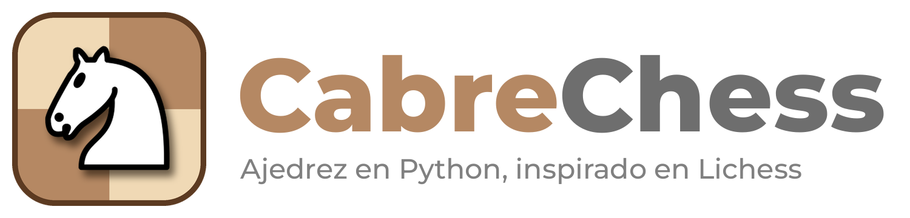
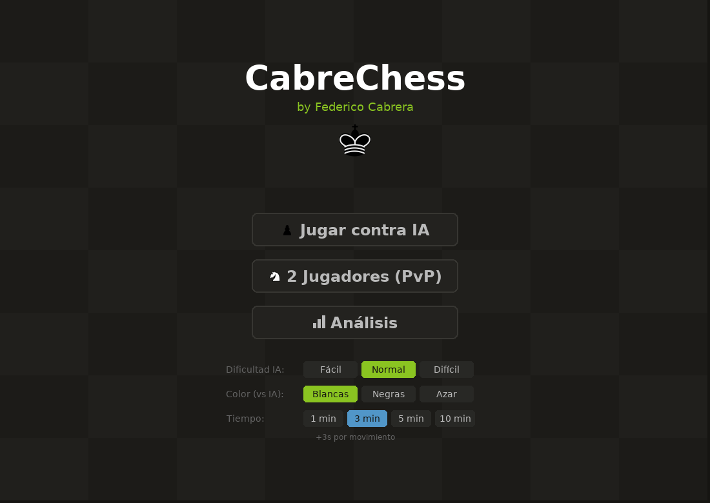
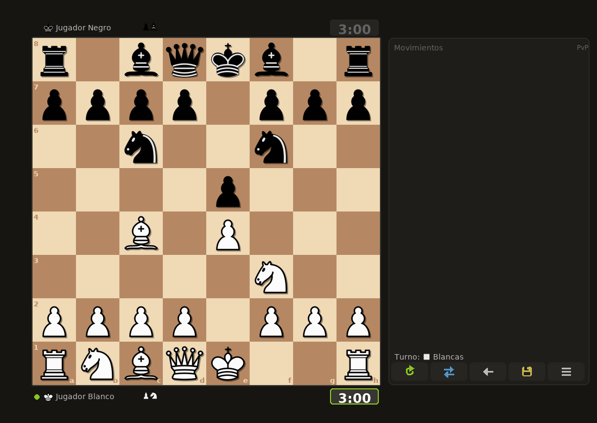
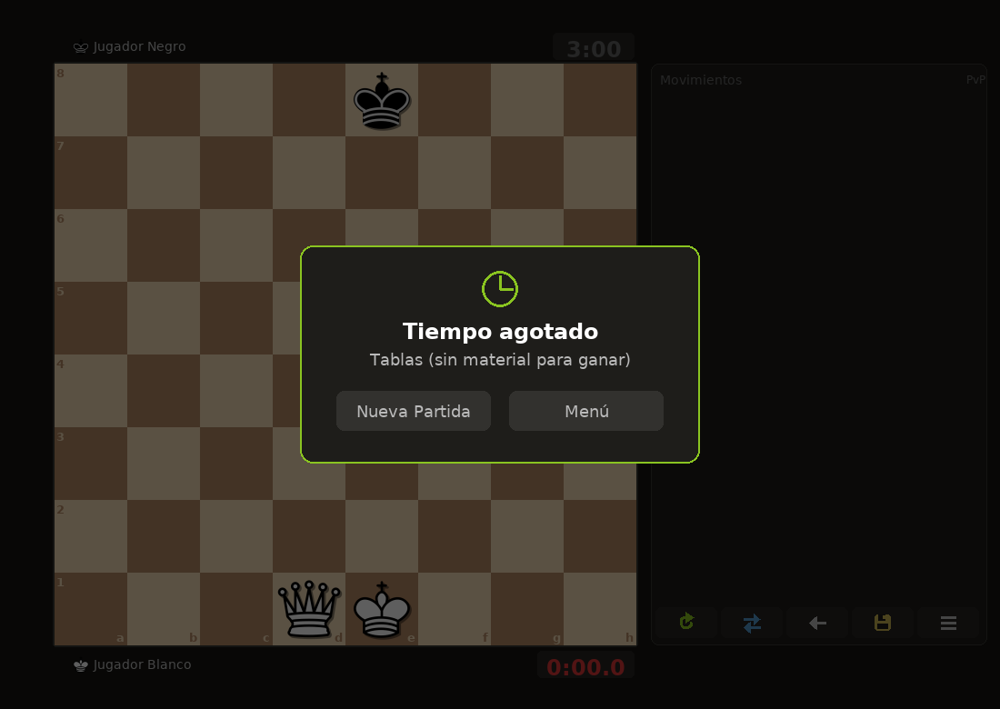

<p align="center">
  
</p>

<p align="center">
  <a href="https://github.com/federicocabrera1978-svg/cabrechess/actions/workflows/ci.yml"></a>
  <a href="LICENSE"></a>
  
</p>

# CabreChess

Ajedrez de escritorio hecho con `pygame` y `python-chess`, inspirado en Lichess.
Por Federico Cabrera.

*[English version below](#english)*

<p align="center">
  
  
</p>
<p align="center">
  
  
</p>

## Funcionalidades

- **Contra la IA** con tres niveles (Fácil / Normal / Difícil). El motor es propio:
  minimax con poda alfa-beta y tablas pieza-casilla, y corre en un hilo aparte para
  que la interfaz no se trabe.
- **Elegís el color** contra la IA: blancas, negras o al azar (con negras el tablero se gira solo).
- **2 jugadores** en la misma compu (PvP).
- **Modo análisis** con barra y gráfico de evaluación.
- **Reloj** de 1, 3, 5 o 10 minutos con +3 s de incremento. Si se te cae la bandera
  y al rival no le alcanza el material para ganar, son tablas (como en el reglamento).
- **Deshacer** completo: devuelve también los relojes, las piezas capturadas y la evaluación.
- **Premoves**, arrastrar y soltar, resaltado de jugadas legales y de la última jugada,
  promoción con selector.
- **Exportar a PGN** (se abre en Lichess, ChessBase, etc.).
- Piezas **cburnett** (las de Lichess) y ejecutable para Windows con checksum SHA-256.

## Controles

| Acción | Cómo |
|---|---|
| Mover | Click en origen y destino, o arrastrar y soltar |
| Premove | Mover una pieza propia mientras le toca al rival |
| Cancelar premove | Click derecho o `Esc` |
| Deshacer | `Ctrl+Z` o el botón ← |
| Girar el tablero | `F` |
| Reiniciar la partida | `R` |
| Volver al menú / salir | `Esc` |
| Guardar PGN | Botón del disquete |

## Requisitos y cómo ejecutarlo

Python **3.9 o más nuevo** (CI usa 3.12).

```
pip install -r requirements.txt
python cabrechess.py
```

O instalarlo como comando (modo editable, así encuentra la carpeta `assets/`):

```
pip install -e .
cabrechess
```

> En Linux, guardar PGN usa el diálogo de `tkinter`; si falta, instalá `python3-tk`.

## Tests y lint

Los tests corren sin pantalla (pygame en modo `dummy`):

```
pip install -r requirements-dev.txt
ruff check .
python -m pytest
```

Cubren el reloj, deshacer, el logo, el motor (encuentra mates en 1 y nunca devuelve
jugadas ilegales) y que el PGN exportado se pueda volver a leer con `chess.pgn`.
CI los corre en Ubuntu y Windows en cada push y PR.

## Descargar el ejecutable (Windows)

Los `.exe` se publican en [Releases](../../releases), junto con un archivo `.sha256`
para verificar que el archivo descargado es exactamente el que se generó a partir del
código fuente publicado en este repositorio:

```powershell
Get-FileHash CabreChess.exe -Algorithm SHA256
```

Compará el resultado con el contenido de `CabreChess.exe.sha256`.

### Por qué Windows o el antivirus pueden marcarlo como sospechoso

El ejecutable no está firmado con un certificado de firma de código (requiere una
identidad verificada y tiene costo). Los `.exe` generados con PyInstaller sin firmar
suelen dar falsos positivos en SmartScreen o en algunos antivirus, porque ese
empaquetado también lo usa malware. El release se genera automáticamente desde este
código fuente público con GitHub Actions (ver `.github/workflows/release.yml`), así que
cualquiera puede auditar exactamente qué se compiló.

Se solicitó firma de código gratuita para proyectos open source a
[SignPath Foundation](https://signpath.org/). Ver [CODE_SIGNING_POLICY.md](CODE_SIGNING_POLICY.md).

## Build local

```
pip install -r requirements-dev.txt
pyinstaller CabreChess.spec
```

El spec empaqueta `assets/` (piezas y logo), usa `assets/logo/cabrechess.ico`
como ícono del `.exe` y toma los metadatos de versión de `version_info.txt`.
El logo se regenera con `python tools/make_logo.py` (necesita Pillow).

## Créditos y licencia

- Piezas: set **cburnett** de Colin M.L. Burnett (GPLv2+), el mismo que usa Lichess.
  Ver `assets/pieces/cburnett/LICENSE`. El logo usa el caballo de ese set.
- Código: **GPL-3.0-or-later**. Ver [LICENSE](LICENSE).

---

## English

**CabreChess** is a desktop chess game written in Python with `pygame` and `python-chess`,
inspired by Lichess.

**Features:** play against a built-in AI (minimax + alpha-beta, 3 levels, runs in a
background thread) as white, black or random; local 2-player mode; analysis mode with
evaluation bar and graph; 1/3/5/10-minute clocks with +3 s increment and proper
flag-vs-insufficient-material handling; full undo (clocks, captures, eval); premoves,
drag and drop, promotion picker; PGN export; Lichess cburnett pieces; Windows `.exe`
built reproducibly by GitHub Actions with a SHA-256 checksum.

**Controls:** click or drag to move · right-click/`Esc` cancels a premove · `Ctrl+Z` undo ·
`F` flip board · `R` restart · `Esc` back to menu / quit.

**Run it** (Python 3.9+):

```
pip install -r requirements.txt
python cabrechess.py
```

**Tests:** `pip install -r requirements-dev.txt && ruff check . && python -m pytest`
(headless, SDL dummy driver). Windows builds are in [Releases](../../releases).

License: GPL-3.0-or-later. Pieces: cburnett by Colin M.L. Burnett (GPLv2+).
